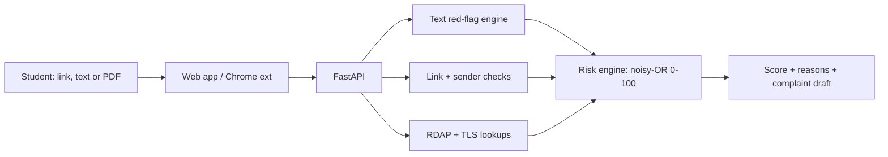

# OwlEye

**See through fake internships.**
OwlEye is an AI-agent-style checker that investigates an internship offer *before* a student applies or pays: it reads the message, checks the link and sender, explains the risk in plain language, and drafts a cybercrime complaint.

Built by team **Night Coders** (Bapuji Institute of Engineering and Technology) for **wHACKiest 2026**, the online ideathon hosted by Ramaiah Institute of Technology.
Pitch deck: [`docs/NightCoders_OwlEye_Pitch.pptx`](docs/NightCoders_OwlEye_Pitch.pptx)

## The problem
Students can't tell a real internship from a fake one until after they've paid. Telangana Police reported 26,809 fake-job scam cases in about 20 months (Jan 2024 to Aug 2025). Existing options (report buttons, generic URL scanners, awareness drives) are reactive: none verifies the offer, explains the risk and helps the student act in the moment.

## What the prototype does today
Paste an offer (text, optional link, sender email, company) and get a **0-100 risk score with evidence-based reasons**.

| Check | Examples of what it catches |
|---|---|
| Message text | "registration / refundable fee", UPI payment demands, "no interview", guaranteed placement, Aadhaar / bank details up front, urgency ("within 24 hours"), moves to WhatsApp / Telegram, unrealistic stipend |
| Link | look-alike brand domains (e.g. `tcs-internship-...xyz`), raw IP, URL shorteners, punycode, throw-away TLDs, no HTTPS |
| Sender | brand claimed but free-mail or non-official domain, domain doesn't match company |
| Live lookups (best effort) | domain age via RDAP, TLS certificate validity. If a lookup fails it adds **no** risk and is listed as "could not verify" |
| Output | score + level, reasons with the exact text found, advice, and a complaint draft for cybercrime.gov.in / helpline 1930 |

**Scoring:** each signal is an independent risk probability; they are combined with a noisy-OR (`1 - prod(1 - w)`), so several weak signals compound but never exceed 100. Levels: LOW 0-24, MEDIUM 25-54, HIGH 55+.

## Pitch vs prototype (honest status)
| Feature in the pitch | Status |
|---|---|
| Rule-based red-flag engine, explainable score | Built |
| URL, sender and brand-impersonation checks | Built |
| Domain age (RDAP) and TLS checks | Built (best effort) |
| Complaint draft (cybercrime.gov.in / 1930) | Built |
| Web UI | Built |
| LLM tool-calling agent (decides which checks to run) | Planned |
| MCA company-registry lookup | Planned |
| Offer-letter PDF parsing and forged-letterhead check | Planned |
| Vector "scam memory" learning from confirmed reports | Planned |
| Chrome extension for LinkedIn / Internshala / Naukri | Planned |
| Safe-internship recommendations, Hindi / Kannada, WhatsApp bot | Planned |

## Architecture

The design principle is **evidence first**: the score comes from verifiable signals, so every verdict is explainable. An LLM layer will later decide *which* checks to run and polish explanations, not invent the verdict.

## Run it
```bash
python -m venv .venv && source .venv/bin/activate
pip install -r requirements-dev.txt
uvicorn backend.app.main:app --reload      # open http://localhost:8000
pytest                                     # run the tests
```
Docker: `docker build -t owleye . && docker run -p 8000:8000 owleye`
Set `OWLEYE_OFFLINE=1` to disable live network lookups.

### API
```bash
curl -X POST localhost:8000/api/analyze -H 'content-type: application/json' -d '{
  "text": "Pay a refundable registration fee of Rs 2000 within 24 hours",
  "sender_email": "tcs.hr@gmail.com", "company": "TCS"}'
```
Fields: `text`, `url`, `sender_email`, `company`, `live` (all optional, at least one of `text`/`url`/`sender_email`). Interactive docs at `/docs`.

## Safety and limits
- Output is a **heuristic estimate, not proof of fraud**; the UI says so.
- Nothing is stored. The server never connects to private/internal addresses (SSRF guard).
- The brand list is a small demo set; a real deployment needs a registry lookup.
- No rate limiting or auth yet; add both before exposing publicly.

## Team
Night Coders: Rishabh (lead), Rakesh. Bapuji Institute of Engineering and Technology.
